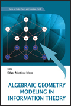
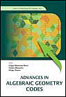
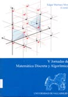

[MathSciNet](https://mathscinet.ams.org/mathscinet/MRAuthorID/657085)

## Preprints

- **Quantum synchronizable codes, polynomial and quasi-polynomial shifts** (with Miguel de los Ríos de Antonio) (2026). Code and data: [qsc-magma](https://github.com/edgarmartinezmoro-web/qsc-magma)

## Journal papers and book chapters

Please feel free to ask me for reprints or electronic files. If you have access to AMS MathScinet you can find my publication profile in [EMM's AMS profile](http://www.ams.org/mathscinet/search/author.html?mrauthid=657085).

- [Galois hulls of constacyclic codes over affine algebra rings](https://doi.org/10.1016/j.disc.2025.114750) (with Indibar Debnath ,Habibul Islam and Om Prakash) Discrete Mathematics (2026) (D.O.I. 10.1016/j.disc.2025.114750)
- [Single server private information retrieval protocols with codes over rings](https://www.worldscientific.com/doi/10.1142/S0219498825410129) (with Seyma Bodur and Diego Ruano) Journal of Algebra and Its Applications (2026) (D.O.I. 10.1142/S0219498825410129)
- [On LCP mixed-alphabet group codes over finite chain rings](https://www.worldscientific.com/doi/10.1142/S1793830925500648) (with Maryam Bajalan, J. de la Cruz and Alexandre Fotue) Discrete Mathematics, Algorithms and Applications (2026) (D.O.I. 10.1142/S1793830925500648)
- [On decoding hyperbolic codes](https://link.springer.com/chapter/10.1007/978-3-031-81824-0_3) (with Eduardo Camps-Moreno , Ignacio García-Marco , Hiram H. López , Irene Márquez-Corbella and Eliseo Sarmiento) WAIFI 2024, LNCS (2025) (D.O.I. 10.1007/978-3-031-81824-0_3)
- [A note on a standard model for Galois rings](https://doi.org/10.1007/s00200-023-00612-8) (with Piñera-Nicolás, A. & Rúa, I.F.) AAECC (2025) (D.O.I. 10.1007/s00200-023-00612-8)
- [On LCP and checkable group codes over finite non-commutative Frobenius rings](https://www.tarupublications.com/doi/10.47974/JDMSC-2187) (with Sanjit Bhowmick, Javier de la Cruz and Anuradha Sharma) Journal of Discrete Mathematical Sciences and Cryptography (2025). (D.O.I. 10.47974/JDMSC-2187)
- [Polycyclic codes over serial rings and their annihilator CSS construction](https://doi.org/10.1007/s12095-024-00757-4) (with Maryam Bajalan) Cryptography and Communications (2025). (D.O.I. 10.1007/s12095-024-00757-4) [Correction](https://link.springer.com/article/10.1007/s12095-025-00787-6)
- [On general self-orthogonal matrix-product codes associated with Toeplitz matrices](https://doi.org/10.1007/s12095-024-00763-6) (with Yang Li and Shixin Zhu) Cryptography and Communications (2025). (D.O.I. 10.1007/s12095-024-00763-6)
- [Abelian and consta-Abelian polyadic codes over affine algebras with a finite commutative chain coefficient ring](https://doi.org/10.1007/s12095-024-00707-0) (with Gülsüm Gözde Yılmazgüç, Javier de la Cruz) Cryptography and Communications (2024). (D.O.I. 10.1007/s12095-024-00707-0)
- [On ℓ-MDS codes and a conjecture on infinite families of 1-MDS codes](https://doi.org/10.1109/TIT.2024.3402745) (with Yang Li and Shixin Zhu) IEEE Trans. Inf. Theory (2024) (D.O.I. 10.1109/TIT.2024.3402745)
- [Locally recoverable codes from towers of function fields](https://doi.org/10.1016/j.ffa.2023.102359) (with Maria Chara and Francisco Galluccio) Finite Fields and Their Applications (2024). (D.O.I. 10.1016/j.ffa.2023.102359)
- [On the structure of repeated-root polycyclic codes over local rings](https://doi.org/10.1016/j.disc.2023.113715) (with Maryam Bajalan, Reza Sobhani, Steve Szabo and Gülsüm Gözde Yılmazgüc) Discrete Mathematics (2024) **Open access** under a Creative Commons license. (D.O.I. 10.1016/j.disc.2023.113715)
- [On the generalized Hamming weights of hyperbolic codes](https://doi.org/10.1142/S0219498825500628) (with Eduardo Camps-Moreno , Ignacio García-Marco , Hiram H. López , Irene Márquez-Corbella and Eliseo Sarmiento) Journal of Algebra and its Applications (2024) (D.O.I. 10.1142/S0219498825500628)
- [The hull of two classical propagation rules and their applications](https://doi.org/10.1109/TIT.2023.3288092) (with Yang Li and Shixin Zhu) IEEE Trans. Inf. Theory (2023) (D.O.I. 10.1109/TIT.2023.3288092)
- [Galois LCD codes over mixed alphabets](https://doi.org/10.1016/j.ffa.2022.102125) (with Maryam Bajalan, Alexandre Fotue and Joel Kabore) Finite Fields and Their Applications (2023) **Open access** under a Creative Commons license. (D.O.I. 10.1016/j.ffa.2022.102125)
- [Private Information Retrieval Schemes Using Cyclic Codes](https://link.springer.com/chapter/10.1007/978-3-031-22944-2_12) (with Seyma Bodur and Diego Ruano) WAIFI 2022 (LNCS,volume 13638) (2023) (D.O.I. 10.1007/978-3-031-22944-2_12)
- [Public Key Protocols over Skew Dihedral Group Rings](https://doi.org/10.3390/math10183343) (with Javier de la Cruz and Ricardo Villanueva Polanco) Mathematics (2022) **Open access** (D.O.I. 10.3390/math10183343)
- [Free Resolutions and Generalized Hamming Weights of Binary Linear Codes](https://doi.org/10.3390/math10122079) (with Ignacio Marco, Irene Marquez and Yuriko Pitones) Mathematics (2022) **Open access** (D.O.I. 10.3390/math10122079)
- [Lifted codes and lattices from codes over finite chain rings](https://doi.org/10.1007/s12095-022-00568-5) (with Lamia Bouzara and Kenza Guenda) Cryptography and Communications (2022) (D.O.I. 10.1007/s12095-022-00568-5)
- [A transform approach to polycyclic and serial codes over rings](https://doi.org/10.1016/j.ffa.2022.102014) (with Maryam Bajalan and Steve Szabo) Finite Fields and Their Applications (2022) **Open access** under a Creative Commons license. (D.O.I. 10.1016/j.ffa.2022.102014)
- [Hulls of cyclic serial codes over a finite chain ring](https://doi.org/10.1016/j.ffa.2021.101950) (with Sarra Talbi, Aicha Batoul and Alexandre Fotue-Tabue) Finite Fields and Their Applications (2022) **Open access** under a Creative Commons license. (D.O.I. 10.1016/j.ffa.2021.101950)
- [Cyclic codes over a non-chain ring Re,q and their application to LCD codes](https://doi.org/10.1016/j.disc.2021.112545) (with Habibul Islam and Om Prakash) Discrete Mathematics (2021) (D.O.I. 10.1016/j.disc.2021.112545)
- [Linear complementary pair of group codes over finite chain rings](https://doi.org/10.1007/s10623-020-00792-1) (with Cem Güneri and Selcen Sayici) Designs, Codes and Cryptography (2020) (D.O.I. 10.1007/s10623-020-00792-1)
- [Computing sharp recovery structures for locally recoverable codes](https://doi.org/10.1007/s10623-020-00746-7) (with I. Marquez-Corbella and C. Munuera) Designs, Codes and Cryptography (2020) (D.O.I. 10.1007/s10623-020-00746-7)
- [Do non-free LCD codes over finite commutative Frobenius rings exist?](https://doi.org/10.1007/s10623-019-00713-x) (with S. Bhowmick, A. Fotue-Tabue, R. Bandi, S. Bagchi) Designs, Codes and Cryptography (2020) (D.O.I. 10.1007/s10623-019-00713-x)
- [Galois correspondence on linear codes over finite chain rings](https://doi.org/10.1016/j.disc.2019.111653) (with A. Fotue and C. Mouaha) Discrete Mathematics (2020) (D.O.I. 10.1016/j.disc.2019.111653)
- [On polycyclic codes over a finite chain ring](https://doi.org/10.3934/amc.2020028) (with A. Fotue and J.T. Blackford) Advances in Mathematics of Communications (2020) (D.O.I. 10.3934/amc.2020028)
- [Vardøhus Codes: Polar Codes Based on Castle Curves Kernels](https://doi.org/10.1109/TIT.2019.2932405) (with E. Camps and E. Sarmiento) IEEE Transactions on Information Theory (2020) (D.O.I. 10.1109/TIT.2019.2932405)
- [General remainder theorem and factor theorem for polynomials over non-commutative coefficient rings](http://dx.doi.org/10.1080/0020739X.2019.1676926) (with A. Cuida, F. Laudano) International Journal of Mathematical Education in Science and Technology (2019) (D.O.I. 10.1080/0020739X.2019.1676926)
- [On counting subring-submodules of free modules over finite commutative Frobenius rings](https://doi.org/10.1007/s10623-017-0446-1) (with R. Bandi and A. Fotue) Designs, Codes and Cryptography (2018) (D.O.I. 10.1007/s10623-017-0446-1)
- [On the Weak Order Ideal Associated to Linear Codes.](https://doi.org/10.1007/s11786-018-0349-1) (With Mijail Borges-Quintana, Miguel A. Borges-Trenard) Mathematics in Computer Science (2018) (D.O.I. 10.1007/s11786-018-0349-1)
- [Additive cyclic codes over finite commutative chain rings](https://doi.org/10.1016/j.disc.2018.03.016) (with K. Otal and Ferruh Ozbudak) Discrete Mathematics (2018) (D.O.I. 10.1016/j.disc.2018.03.016)
- [Codes over affine algebras with a finite commutative chain coefficient ring](http://doi.org/10.1016/j.ffa.2017.09.008) (with I. F. Rua and A. P. Nicolas) Finite Fields and Their Applications (2018) (D.O.I. 10.1016/j.ffa.2017.09.008)
- [Multivariable codes in principal ideal polynomial quotient rings with applications to additive modular bivariate codes over F4](http://doi.org/10.1016/j.jpaa.2017.04.007) (with I. F. Rua and A. P. Nicolas) Journal of Pure and Applied Algebra (2018) (D.O.I. 10.1016/j.jpaa.2017.04.007)
- [Trial Set and Groebner Bases for Binary Codes.](https://link.springer.com/book/10.1007%2F978-3-319-56932-1) (With Mijail Borges-Quintana, Miguel A. Borges-Trenard) Springer Proceedings in Mathematics & Statistics (2017).
- [Applications of Computer Algebra](https://link.springer.com/book/10.1007%2F978-3-319-56932-1) . (Edited with Ilias Kotsireas), Springer Proceedings in Mathematics & Statistics (2017). [Foreword - Front matter](https://link.springer.com/content/pdf/bfm%3A978-3-319-56932-1%2F1.pdf)
- [On the ideal associated to any linear code](http://dx.doi.org/10.3934/amc.2016003) (with I. Marquez-Corbella and E. Suarez) Advances in Mathematics of Communications (2016) (D.O.I. 10.3934/amc.2016003)
- [Algebra for Secure and Reliable Communication Modeling](http://dx.doi.org/10.1090/conm/642) . (Edited with Mustapha Lahyane) , Contemp. Math., Amer. Math. Soc (2015). (DOI:10.1090/conm/642). [Foreword - Front matter](/files/conm642-endmatter.pdf)
- [A Semigroup Approach to Complete Decoding](http://dx.doi.org/10.1090/conm/642) . (With I. Marquez-Corbella) Algebra for Secure and Reliable Communication Modeling, Contemp. Math., Amer. Math. Soc (2015).
- **Computer algebra in coding theory and cryptography** (Edited with Ilias S. Kotsireas) Special Issue of [Designs, Codes and Cryptography](http://link.springer.com/journal/10623/76/1/page/1). July 2015, Volume 76, Issue 1.
- [Computing Coset Leaders and Leader Codewords of Binary Codes](http://dx.doi.org/10.1142/S0219498815501285). (With M.A. Borges, M. Borges and I. Marquez-Corbella) Journal of Algebra and its Applications, Volume 14, Issue 08, (2015).(DOI: 10.1142/S0219498815501285)
- [On a class of repeated-root monomial-like abelian codes](http://www.dergiler.yildiz.edu.tr/AjaxTool/GetArticleByPublishedArticleId?PublishedArticleId=2117). (With H. Ozadan, F. Ozbudak and S. Szabo) Journal of Algebra Combinatorics Discrete Structures and Applications, Volume: 2, Issue: 2, pp:1-10 (2015).
- [Linear Codes Over Z_4 \[x\]/(x^2 +2x)](http://www.inderscience.com/info/inarticle.php?artid=68698). (With S. Szabo and B. Yildiz) The International Journal of Information and Coding Theory, Vol.3, No.1 pp.78 - 96 (2015).
- [On codes over local Frobenius non-chain rings of order 16](http://dx.doi.org/10.1090/conm/634/12702). (With S. Szabo) In Noncommutative Rings and Their Applications, volume 634 of Contemp. Math., pages 227-243. Amer. Math. Soc (2015).
- [On the Composition of Secret Sharing Schemes Related to codes](http://www.worldscientific.com/doi/abs/10.1142/S179383091450013X). (With I. Marquez-Corbella and E. Suarez-Canedo) Discrete Math., Alg. and Appl. 6(1) (2014). (DOI: 10.1142/S179383091450013X)
- [On additive modular bivariate codes over F_4](http://dx.doi.org/10.1016/j.ffa.2014.02.007). (With A.P. Nicolas and I.F. Rua) Finite Fields and their Applications. 28, pp. 199 - 213. (2014). (DOI: 10.1016/j.ffa.2014.02.007)
- [Computational aspects of retrieving a representation of an algebraic geometry code](http://dx.doi.org/10.1016/j.jsc.2013.12.007). (with I. Marquez-Corbella, R. Pellikaan and D. Ruano) Journal of Symbolic Computation (2014). (DOI: 10.1016/j.jsc.2013.12.007)
- **Computer algebra in coding theory and cryptography** (Edited with Iliya Bouyukliev, Stanislav Bulygin) Special Issue of [Applicable Algebra in Engineering, Communication and Computing](http://link.springer.com/article/10.1007%2Fs00200-013-0199-7). August 2013, Volume 24, Issue 3-4.
- [On Trace Codes and Galois Invariance over Finite Commutative Chain Rings](http://dx.doi.org/10.1016/j.ffa.2013.03.004). (with A.P. Nicolas and I.F. Rua) Finite Fields and Their Applications Volume 22, July 2013, Pages 114-121. (DOI: 10.1016/j.ffa.2013.03.004) [Corrigendum](http://dx.doi.org/10.1016/j.ffa.2013.05.002) (DOI: 10.1016/j.ffa.2013.05.002)
- [An Introduction to LDPC Codes.](http://www.worldscientific.com/worldscibooks/10.1142/8049) (with I. Marquez-Corbella) World Scientific Series on Coding Theory and Cryptology: Volume 8.
- [On the unique representation of very strong algebraic geometry codes](http://dx.doi.org/10.1007/s10623-012-9758-3). (with I. Marquez-Corbella and R. Pellikaan) Designs, Codes and Cryptography. (2013). (DOI: 10.1007/s10623-012-9758-3)
- [The non-gap sequence of a subcode of a generalized Reed-Solomon code](http://dx.doi.org/10.1007/s10623-012-9694-2). (with I. Marquez-Corbella and R. Pellikaan) Designs, Codes and Cryptography. (2013). (DOI: 10.1007/s10623-012-9694-2)
- [Additive semisimple multivariable codes over F_4](http://dx.doi.org/10.1007/s10623-012-9641-2). (with I. F. Rua and A. P. Nicolas) Designs, Codes and Cryptography.Volume 69, Issue 2, pp 161-180 (2013). (DOI: 10.1007/s10623-012-9641-2)
- **Matroids in Coding Theory and Related Topics** (Edited with Ilias S. Kotsireas and Irene Marquez-Corbella) Special Issue of [Mathematics in Computer Science](http://dx.doi.org/10.1007/s11786-012-0116-7). Volume 6, Number 2 (2012).
- [Decomposition of Modular Codes for Computing Test Sets and Graver Basis](http://dx.doi.org/10.1007/s11786-012-0120-y) . (with I. Marquez-Corbella) Mathematics in Computer Science, volume 6, Number 2, (2012). Pages: 147-165 (DOI: 10.1007/s11786-012-0120-y)
- [Algebraic structure of the minimal support codewords set of some linear codes](http://dx.doi.org/10.3934/amc.2011.5.233) . (with I. Marquez-Corbella) Advances in Mathematics of Communications (AMC), volume 5, Issue 2, May 2011. Pages: 233-244 (DOI: 10.3934/amc.2011.5.233)
- **An Algebraic View to Gradient Descent Decoding** (with E. Martinez-Moro, M. ángel Borges Trenard, Mijail Borges Quintana) IEEE Information Theory Workshop, Dublin, August 30 - September 3, 2010. [IEEExplore](http://ieeexplore.ieee.org)
- **Algebraic Coding Theory and Applications** (Edited with Antonio Campillo, Patrick Fitzpatrick and Ruud Pellikaan) Special Issue of the [Journal of Symbolic Computation](http://www.elsevier.com/wps/find/journaldescription.cws_home/622902/description#description). Volume 45, Issue 7, Pages 721-824 (July 2010)
- [Gröbner representations of binary matroids](http://www.springerlink.com/content/g4kw85h65pxx713q/) (With M. Borges-Quintana, M. A. Borges-Trenard) In Bras-Amoros, Maria (ed.) et al., Applied algebra, algebraic algorithms and error-correcting codes. 18th international symposium, AAECC-18. Lecture Notes in Computer Science 5527, 227-230 (2009).
- **An application of Möller's algorithm to coding theory** (With M. Borges-Quintana, M. A. Borges-Trenard) In [Gröbner bases, coding, and cryptography](http://www.springer.com/mathematics/algebra/book/978-3-540-93805-7). 379-384 Edited by Massimiliano Sala, Teo Mora, Ludovic Perret, Shojiro Sakata and Carlo Traverso. Springer-Verlag, Berlin, 2009.
- **Mattson Solomon transform and algebra codes** (With D. Ruano). In [Gröbner bases, coding, and cryptography](http://www.springer.com/mathematics/algebra/book/978-3-540-93805-7). 385-388 Edited by Massimiliano Sala, Teo Mora, Ludovic Perret, Shojiro Sakata and Carlo Traverso. Springer-Verlag, Berlin, 2009.
- **Toric codes** (With D. Ruano). In [Advances in Algebraic Geometry Codes](http://www.worldscibooks.com/mathematics/6767.html), 295-322, Ser. Coding Theory Cryptol., 5, World Sci. Publ., Hackensack, NJ, 2008.
- [Gröbner bases and combinatorics for binary codes](http://dx.doi.org/10.1007/s00200-008-0080-2) (with M. Borges Quintana, M.A. Borges-Trenard and P. Fitzpatrick) in Applicable Algebra in Engineering, Communication and Computing. (DOI: 10.1007/s00200-008-0080-2)
- [On semisimple algebra codes: generator theory](http://adm.lnpu.edu.ua/downloads/issues/2007/N3/adm-n3-11.pdf) Algebra and Discrete Mathematics.(2007) Number 3.
- [On repeated-root multivariable codes over a finite chain ring](http://dx.doi.org/10.1007/s10623-007-9114-1) (with I.F. Rua) Designs, Codes and Cryptography 45:2 November 2007.(DOI: 10.1007/s10623-007-9114-1)
- **A Gröbner Representation for Linear Codes** . (with M. Borges Quintana and M.A. Borges-Trenard) In [Advances in Coding Theory and Cryptography](http://www.worldscibooks.com/mathematics/6464.html) edited by T Shaska, W C Huffman, D Joyner and V Ustimenko. Pages 17-32. Aug. 2007. World Scientific.
- **On a Gröbner bases structure associated to linear codes**. (with M. Borges Quintana and M.A. Borges-Trenard) Journal of Discrete Mathematical Sciences and Cryptography. March 2007. 151-191
- [A General Framework for Applying FGLM Techniques to Linear Codes](http://dx.doi.org/10.1007/11617983_7) . (with M. Borges-Quintana and M.A. Borges-Trenard) AAECC'16, Lecture Notes in Computer Science, (3857). Dec. 2006. Pages: 76-86 (DOI: 10.1007/11617983_7)
- [Multivariable Codes Over Finite Chain Rings: Serial Codes](http://dx.doi.org/10.1137/050632208). (with I.F. Rua) SIAM Journal on Discrete Mathematics. Volume 20 Issue 4 Dec. 2006. Pages 947-959. (DOI: 10.1137/050632208)
- [The symmetric group given by a Gröbner basis](http://dx.doi.org/10.1016/j.jpaa.2005.09.011). (with M. Borges-Quintana, M.A. Borges-Trenard and J.A. Castellanos-Garzón) Journal of Pure and Applied Algebra Volume 207, Issue 1, September 2006, Pages 149-154. (DOI: 10.1016/j.jpaa.2005.09.011)
- [Compounding Secret Sharing Schemes](http://ajc.math.auckland.ac.nz/volume_contents.php3?vol=30). (with C.Munuera and J. Mozo) Australian Journal of Combinatorics, 30, September 2004, pages 277-290.
- [A generalization of Niederreiter-Xing's propagation rule and its commutativity with duality](http://dx.doi.org/10.1109/TIT.2004.825036). IEEE Trans. on Inf. Theory, Volume: 50,Issue: 4 April 2004, pp. 701- 702.(DOI: 10.1109/TIT.2004.825036)
- [Regular Representations of Finite-dimensional Separable Semisimple Algebras and Gröbner Bases](http://dx.doi.org/10.1016/j.jsc.2003.08.001). Jour. Symbolic Computation. Volume 37, Issue 5, May 2004, Pages 575-587 (DOI: 10.1016/j.jsc.2003.08.001)

- [On the structure of multipliers of Z2](http://dx.doi.org/10.1155/S0161171203203124). (with R. Canogar-McKenzie) . Int. Jour. Mathematics and Mathematical Sciences. vol. 15 (2003), Pages: 935--946 (DOI: 10.1155/S0161171203203124)
- [Properties of Commutative Association Schemes derived by FGLM Techniques](http://dx.doi.org/10.1142/S021819670200119X).International Journal of Algebra and Computation. vol. 12 no. 6 (2002). Pages: 849--865 (DOI: 10.1142/S021819670200119X)
- [Majority-logic-decodable cyclic arithmetic-modular AN-codes in 1, 2 and L steps](http://link.springer.de/link/service/series/0558/bibs/2260/22600128.htm). (with F. Javier Galán y J.G. Tena). In Cryptography and Coding. Bahram Honary (Ed.). Lecture Notes in Computer Science. Springer Verlag. Vol. 2260, Páginas: 128-137, 2001
- [Combinatorial Structure of Finite Fields with Two Dimensional Modulo Metrics](http://link.springer.de/link/service/series/0558/bibs/1746/17460045.htm). (with F. Javier Galán Simon, M. ángel Borges Trenard, Mijail Borges Quintana). In Cryptography and Coding.Mike Walker (Ed.). Lecture Notes in Computer Science. Springer Verlag. Vol. 1746, Pages: 45-55, 1999.
- **Computations on character tables of association schemes**. In Computer Algebra in Scientific Computing. CASC99. V.G. Ganzha, E.W. Mayr, E.W. Vorozhtsov (Eds.) Springer Verlag, Munich 1999. Pages: 293-307
- **Exploring self-dual codes with Maple**. Maple Tech. Birhäuser. Volumen: 5, 1. Pages 37-41. 1998.

## Books

-  [Algebraic Geometry Modeling in Information Theory.](http://www.worldscientific.com/worldscibooks/10.1142/8049) (Editor) Feb 2013. World Scientific Series on Coding and Cryptography, vol. 8.
-  [Advances in Algebraic Geometry Codes](http://www.worldscientific.com/worldscibooks/10.1142/6767) (Editor with Diego Ruano y Carlos Munuera). May 2008. World Scientific Series on Coding and Cryptography. vol 5.
- [Introducción a los anillos finitos y sus aplicaciones](/files/EVM2014.pdf) (in Spanish) con A. P. Nicolas y I.F. Rua. Septiembre 2014. Instituto Venezolano de Investigaciones Científicas. 121 páginas. (ISBN: 78-980-261-151-5)
- [Bases de Gröbner: aplicaciones a la codificación algebraica](/files/XXevm.pdf) (in Spanish) con Diego Ruano y Carlos Munuera. Septiembre 2007. Instituto Venezolano de Investigaciones Científicas. 125 páginas. (ISBN: 978-980-261-087-7)
-  V Jornadas de Matemática Discreta y Algorítmica. (Coordinador,in Spanish) Julio 2006. Secretariado de Publicaciones de la UVa. 446 páginas. (ISBN: 84-8448-380-0)

## Software

[New decoding error-correcting codes algorithm for Sage](http://broniks.blogspot.com.es/search/label/sage) by Verónica Suaste, supported by Google Summer of code 2013.

[GBLA_LC](http://www.math.arq.uva.es/~edgar/GBLAweb/): A GAP package for computing Grobner Bases by Linear. Algebra and Linear Codes.

Presented at the International Congress of Mathematics (with M. Borges-Quintana and M.A. Borges-Trenard), see the extended [abstract](http://www.icm2006.org/v_f/AbsDef/MathSoft/abs_1073.ext.pdf).

## Supervised students

**Cristina Garcia Gonzalez** Undergraduate. Graduate Thesis. Main results published as:

Quintana, M. B.; Trenard, M. B.; Garcia-Gonzalez, C.; Martinez, E. **The partial order associated with the equivalence classes of a binary code**. (Spanish) Sixth Conference on Discrete Mathematics and Computer Science (Spanish), 509-516, Univ. Lleida, Lleida, 2008.

------------------------------------------------------------------------

**[Irene Marquez Corbella](http://www.singacom.uva.es/~iremarquez/)** PhD Student. FPU grant from the Spanish Research Ministry. September 2009-2013.

Master thesis [Presentaciones binomiales de programas lineales modulares: Aplicaciones a los códigos correctores de errores](/files/deairene.pdf) (in Spanish) 07/2010. Calificación: Sobresaliente (9,5).

PhD Thesis: July 2013 [Combinatorial Commutative Algebra Approach to Complete Decoding](http://www.singacom.uva.es/~iremarquez/Thesis-Irene.pdf). Sobresaliente Cum Laude.

## PhD Thesis

I quite doubt it, but maybe someone is interested in my PhD thesis: Estructura combinatoria de métricas no Hamming (in Spanish) 07/2001. Advisor: Dr. Fco. Javier Galán Simón. Calificación: Sobresaliente "cum laude".
[Download (zip)](/files/tesis.zip)
